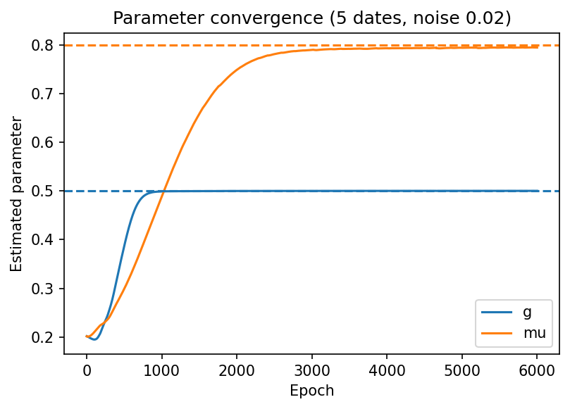
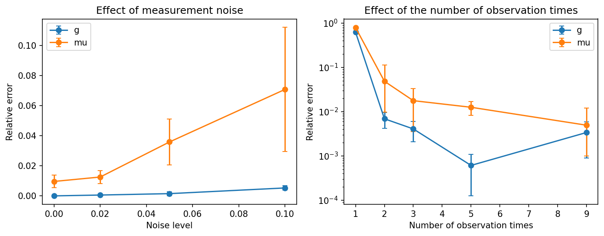
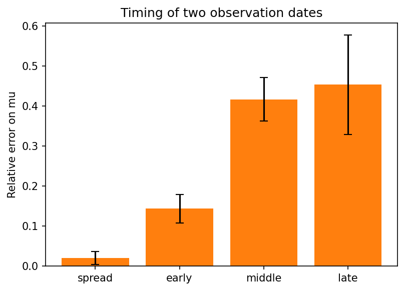

# Physics-Informed Neural Network for inverse problems in a structured population model (toy study)

Small exploratory project: can a Physics-Informed Neural Network (PINN) recover the
growth and mortality parameters of a transport–reaction PDE from sparse, noisy
observations, and how do the noise level and the number and timing of observation
dates affect the inference?

## Model
Size-structured population density u(t, x) on x in [0, 1], t in [0, 1]:

    du/dt + g du/dx = -mu u

with Gaussian initial distribution. The exact solution is known (method of
characteristics), which allows synthetic data generation and a check of the results.
True values: g = 0.5 (growth speed), mu = 0.8 (mortality rate).

## Method
- Synthetic data: u observed on 40 positions at several dates, with additive Gaussian noise (default standard deviation 0.02).
- PINN: MLP (3 hidden layers of 64 tanh units) taking (t, x) and returning u. The parameters g and mu are trainable (kept positive with a softplus). Loss = data mean squared error + PDE residual on random collocation points. Adam optimizer, learning rate 1e-3.
- Reference run: 5 dates, noise 0.02, 6000 epochs. Experiments: 3000 epochs, 1000 collocation points, 3 random seeds (mean ± std).

## Results
Reference run: g = 0.500, mu = 0.795 (true 0.5 and 0.8).



**Noise and number of dates** (relative error on mu, mean ± std over 3 seeds):

| Noise (5 dates) | 0 | 0.02 | 0.05 | 0.10 |
|---|---|---|---|---|
| Error on mu | 1.0 ± 0.4% | 1.3 ± 0.4% | 3.6 ± 1.5% | 7.1 ± 4.1% |

| Number of dates (noise 0.02) | 1 | 2 | 3 | 5 | 9 |
|---|---|---|---|---|---|
| Error on mu | 79 ± 1% (fails) | 4.9 ± 6.4% | 1.8 ± 1.5% | 1.3 ± 0.4% | 0.5 ± 0.7% |

The growth speed g is recovered with an error below about 1% as soon as two dates are available, whatever the noise level tested. With a single date, neither parameter is recovered (estimates stay close to the initial guess).



**Timing of two observation dates** (relative error on mu):

| Dates | (0, 1) | (0, 0.25) | (0.4, 0.6) | (0.75, 1) |
|---|---|---|---|---|
| Error on mu | 2.0 ± 1.6% | 14.4 ± 3.6% | 41.7 ± 5.5% | 45.4 ± 12.4% |

At a fixed gap of 0.5 between the two dates, the error on mu increases when the dates move later: 1.9 ± 1.8% (0, 0.5), 4.9 ± 6.4% (0.25, 0.75), 8.2 ± 5.6% (0.5, 1).



## Interpretation
- With one date, the problem looks non-identifiable: the shift due to g and the attenuation due to mu cannot be separated from an unknown initial condition. This is a plausible explanation consistent with the experiment, not a proof.
- Mortality is harder to estimate than growth speed, and is more sensitive to noise.
- Widely spaced dates give a much better estimate of mu than close dates. Both the gap between dates and their position seem to matter; a possible reason is that the signal decays as exp(-mu t) while the noise level is constant (hypothesis, not tested directly).

## Limitations
- Toy model with constant parameters and a known exact solution; no real data.
- Only 3 random seeds per setting: only large differences should be trusted (for example 1 date vs 3 dates, wide vs close dates).
- A residual bias of about 1% on mu remains even without noise, which comes from optimization (number of epochs and collocation points) and not from the noise.
- Hyperparameters were not tuned; no formal identifiability analysis, global sensitivity analysis or uncertainty quantification yet.

## Next steps
Size-dependent growth g(x) and recruitment term, estimation of unknown functions, more seeds, practical identifiability and uncertainty quantification (for example profile likelihood), comparison with classical optimization.

## Run
```
pip install -r requirements.txt
```
Then open `pinn_structured_population_inverse.ipynb (works in Google Colab; a GPU is optional).
